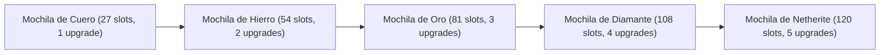
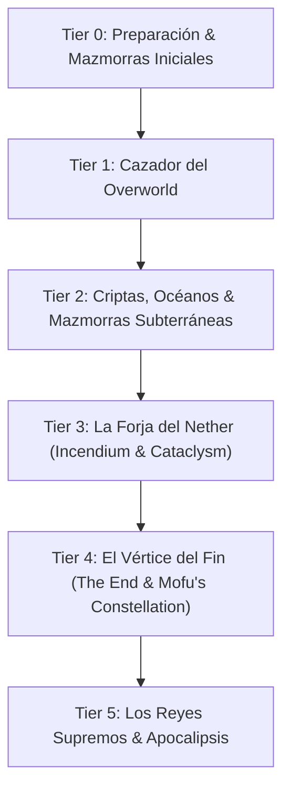

# 🗡️ Wiki del Modpack & Guía de Progresión de Jefes (Forge 1.20.1)

Bienvenido a la enciclopedia oficial del modpack. Este documento detalla todos los sistemas principales, mecánicas de combate, controles, **bestiario con debilidades de jefes**, **guía de minería y capas (Y-levels)**, **consejos de mejoras de equipo** y una **ruta estructurada por niveles (Tiers)**.

---

## 📑 Tabla de Contenidos
1. [Sistemas y Mecánicas Principales](#1-sistemas-y-mecánicas-principales)
2. [⌨️ Guía Maestra de Teclado & Resolución de Conflictos](#2-guía-maestra-de-teclado--resolución-de-conflictos)
3. [👹 Bestiario: Jefes, Mecánicas & Debilidades](#3-bestiario-jefes-mecánicas--debilidades)
4. [⛏️ Guía de Minería: Capas (Y-Levels) y Materiales de Crafteo](#4-guía-de-minería-capas-y-levels-y-materiales-de-crafteo)
5. [🛡️ Guía de Mejoras de Equipamiento y Progresión](#5-guía-de-mejoras-de-equipamiento-y-progresión)
6. [Ruta de Progresión de Jefes e Historia (Tiers 0 a 5)](#6-ruta-de-progresión-de-jefes-e-historia)
7. [Enciclopedia de Mods por Categorías](#7-enciclopedia-de-mods-por-categorías)
8. [Consejos Clave de Supervivencia](#8-consejos-clave-de-supervivencia)

---

## 1. Sistemas y Mecánicas Principales

### ⚔️ Combate Fluido (*Better Combat*)
* **Combos y Variedad de Armas:** Cada tipo de arma (katanas, mandobles, lanzas, dagas, hachas de guerra) posee animaciones de ataque en cadena, alcance (*reach*) específico y velocidades de golpe diferenciadas.
* **Ataque a través de la vegetación:** Puedes golpear libremente a enemigos detrás de hierba alta sin que tu golpe sea bloqueado.
* **Dual Wielding:** Puedes empuñar dos armas (una en cada mano) para encadenar combos alternados a dos manos.

### 🪂 Resistencia, Vida y Parapente (*Paraglider*)
* **Stamina:** Correr, planear y ciertas acciones consumen la barra de resistencia verde.
* **Estatuas de la Diosa (Goddess Statues):** Encuéntralas en aldeas o estructuras. Ofrece **4 Spirit Orbs / Contenedores de Corazón** para aumentar permanentemente tus corazones de vida o tu barra de stamina.
* **Paraglider:** Craftea el parapente para explorar verticalmente y salvarte de caídas mortales.

### 💍 Reliquias y Accesorios (*Curios API + Relics*)
* Presiona <kbd>G</kbd> (o el icono de anillo en el inventario) para equipar anillos, cinturones, collares y reliquias activas que otorgan saltos dobles, resistencia elemental o daño mágico.

### 📦 Almacenamiento & Teletransporte
* **Sophisticated Backpacks:** Mochilas mejorables con filtros de recogida automática, mejoras de alimentación, compresión y magnetismo.
* **Waystones:** Monolitos de viaje rápido repartidos por aldeas y mazmorras. Actívalos haciendo clic derecho para teletransportarte entre ellos consumiendo experiencia o usando *Warp Stones*.
* **Lootr:** Cada cofre de mazmorra tiene textura dorada/metálica y genera botín instanciado individualmente para cada jugador.

---

## 2. ⌨️ Guía Maestra de Teclado & Resolución de Conflictos

| Acción / Menú | Tecla Recomendada | Mod Asociado | Notas de Uso |
| :--- | :---: | :--- | :--- |
| **Habilidad Especial de Arma** | <kbd>R</kbd> | *Soulslike Weaponry* | Ejecuta el ataque mágico/arte del arma equipada (ej. *Moonveil*). |
| **Parry / Desvío con Escudo** | <kbd>V</kbd> | *Soulslike Weaponry* | Bloqueo en el instante exacto para aturdir al enemigo. |
| **Transformar Arma de Truco** | <kbd>Z</kbd> | *Soulslike Weaponry* | Cambia el modo o postura de armas de truco. |
| **Rodar / Esquivar (Roll)** | <kbd>Alt Izq</kbd> | *Monster Expansion / Bosses Rise* | Esquive rápido con fotogramas de invulnerabilidad. |
| **Abrir Mochila en Espalda** | <kbd>B</kbd> | *Sophisticated Backpacks* | Abre tu mochila directamente sin ponerla en el suelo. |
| **Auto-Organizar Inventario** | <kbd>Clic Rueda</kbd> | *Sophisticated Backpacks* | Ordena cofres y mochilas por categoría al instante. |
| **Menú de Curios (Accesorios)** | <kbd>G</kbd> | *Curios API* | Abre ranuras de anillos, collares y amuletos. |
| **HUD de Reliquias Activas** | <kbd>X</kbd> | *Relics* | Despliega el selector de habilidades activas de reliquias. |
| **Zoom de Cámara** | <kbd>C</kbd> | *Just Zoom* | Zoom suave para explorar a larga distancia. |
| **Abrir Mapa de Pantalla Completa** | <kbd>M</kbd> | *Xaero's World Map* | Mapa interactivo con relieve y marcadores. |
| **Crear Waypoint (Marcador)** | <kbd>N</kbd> | *Xaero's Minimap* | Marca coordenadas de tu base o mazmorras descubiertas. |
| **Lista de Waypoints** | <kbd>U</kbd> | *Xaero's Minimap* | Administrar puntos de ruta visibles en el mapa. |
| **Diario de Misiones** | <kbd>J</kbd> | *RealmRPG Quests* | Abre la lista de misiones activas. |
| **Menú de Estadísticas RPG** | <kbd>K</kbd> | *Memory of the Past* | Ver estadísticas de personaje y recuerdos. |
| **Lista de Jefes (Boss Checklist)** | <kbd>L</kbd> | *Boss Checklist* | Consulta qué jefes ya venciste y cuáles faltan. |

---

## 3. 👹 Bestiario: Jefes, Mecánicas & Debilidades

A continuación se detallan las mecánicas de combate y puntos débiles clave de los jefes más peligrosos:

### 🌋 L_Ender's Cataclysm
* **Netherite Monstrosity (Soul Blacksmith - Nether):**
  * *Mecánica:* Ataques de área masivos y proyectiles de lava. Alta armadura frontal.
  * *Debilidad:* Es extremadamente lento. Golpea su espalda tras esquivar sus martillazos. No te pares en el suelo de magma. Usa armas con daño penetrante o arcos de gran alcance.
* **Ignis (Burning Arena - Nether):**
  * *Mecánica:* Combos frenéticos con espada de fuego y salto en picada con impacto de meteorito.
  * *Debilidad:* **Poción de Resistencia al Fuego obligatoria**. Es vulnerable al daño de hielo/congelación (*Aquamirae*). Cuando salte al aire, rueda hacia un lado para evitar el impacto.
* **The Harbinger (Ancient Factory - Subsuelo Overworld):**
  * *Mecánica:* Rayos láser continuos, ráfagas de misiles teledirigidos y ondas PEM que desactivan tecnología.
  * *Debilidad:* Cúbrete detrás de los pilares de la fábrica durante la ráfaga de misiles. Cuando termine su ataque cargado, quedará sobrecalentado y vulnerable durante 4 segundos.
* **The Leviathan (Sunken City - Abismo del End/Océano):**
  * *Mecánica:* Cargas submarinas, torbellinos que atraen al jugador y láser abisal.
  * *Debilidad:* Encantamientos *Impaling (Empalamiento V)* y *Aqua Affinity*. Usa tridentes arrojadizos con *Loyalty* para atacarlo sin entrar en su rango de mordida.
* **Ender Guardian (Ruined Citadel - The End):**
  * *Mecánica:* Escudo de vacío, teletransportación rápida y empujes letales al vacío.
  * *Debilidad:* Los ataques pesados con hachas o mandobles rompen su escudo de vacío. Pelea en el centro de la arena para evitar salir despedido al vacío.

---

### ❄️ Mowzie's Mobs
* **Ferrous Wroughtnaut (Wrought Chamber - Subsuelo):**
  * *Mecánica:* Inmune a todo tipo de daño por el frente y costados (armadura 100% impenetrable).
  * *Debilidad:* Cuando descargue su hacha vertical contra el suelo, quedará atascada durante 3 segundos. **Ataca la gema roja brillante de su espalda**.
* **Frostmaw (Picos Nevados):**
  * *Mecánica:* Rayo congelador de hielo continuo y golpes sísmicos.
  * *Debilidad:* Inicia el combate con un golpe crítico sigiloso mientras duerme. Es altamente vulnerable al daño de fuego (*Fire Aspect / Ignitium*).
* **Barako, the Sun Chief (Aldeas de Sabana):**
  * *Mecánica:* Dispara rayos solares continuos e invoca hordas de máscaras Barakoa.
  * *Debilidad:* Elimina primero a los súbditos Barakoa para que no desvíen tus ataques. Ataca a Barako con armas rápidas mientras canaliza su recarga solar.

---

### 🌊 Aquamirae
* **Captain Cornelia (Barco Fantasma en el Ice Maze):**
  * *Mecánica:* Desaparición espectral, tajos giratorios congelantes y niebla helada.
  * *Debilidad:* El daño de fuego interrumpe sus teletransportes. Mantente a distancia media; si te alejas demasiado, ejecutará una embestida imbloqueable.
* **Mother of the Ice Maze (Laberinto Submarino):**
  * *Mecánica:* Tentáculos de largo alcance y ceguera marina.
  * *Debilidad:* Combos de *Better Combat* a dos manos con daño crítico masivo y pociones de respiración acuática.

---

### 💀 The Graveyard & From The Shadows
* **Corrupted Champion (The Graveyard - Gran Mausoleo):**
  * *Mecánica:* Invoca esqueletos acólitos y lanza ondas oscuras de drenaje de vida.
  * *Debilidad:* Encantamiento *Smite (Castigo V)* en armas pesadas. Destruye a los acólitos que canalizan su regeneración.
* **Nehemoth (From The Shadows - Cavernas Deepslate):**
  * *Mecánica:* Rugido que reduce la armadura del jugador y mordiscos con desgarro.
  * *Debilidad:* Parar su ataque inicial con escudo (*Parry*) lo aturde. Usa armas sagradas o daño mágico.
* **Bulldrogioth (From The Shadows):**
  * *Mecánica:* Carga frontal como un ariete que lanza al jugador por los aires.
  * *Debilidad:* Esquiva rodando hacia un lateral (<kbd>Alt Izq</kbd>) cuando inicie la carga; se estrellará contra la pared y quedará aturdido.

---

### 🧟 Mutant Monsters
* **Mutant Zombie:**
  * *Mecánica:* Golpes de onda expansiva y regeneración al caer derrotado.
  * *Debilidad:* **Obligatorio quemar su cuerpo con mechero (*Flint and Steel*) en el suelo cuando caiga**, de lo contrario revivirá con el 50% de vida hasta 3 veces.
* **Mutant Skeleton:**
  * *Mecánica:* Dispara 3 flechas simultáneas con perforación y atrapa en costillas de hueso.
  * *Debilidad:* Pelea cuerpo a cuerpo pegado a él con armas duales rápidas para anular su precisión con el arco.
* **Mutant Creeper:**
  * *Mecánica:* Saltos de gran altura que provocan explosiones al aterrizar e invoca crías de creeper.
  * *Debilidad:* Golpea inmediatamente después de que aterrice antes de que inicie su carga explosiva.

---

## 4. ⛏️ Guía de Minería: Capas (Y-Levels) y Materiales de Crafteo

Con la generación de terreno de Minecraft 1.20.1 y los mods de estructuras, estos son los niveles óptimos para minar y conseguir cada recurso:

```text
  Y: 256 + ---------------------------------------- Picos Montañosos (Carbón Y: 136, Hierro Y: 232, Esmeraldas Y: 224)
           |
  Y: 64    | === Nivel del Mar del Overworld ===
           | Cobre (Y: 48)
  Y: 16    | Hierro Óptimo (Y: 16) | Oro en Badlands (Y: 32 a 256)
  Y: 0     | Lapislázuli Óptimo (Y: 0) | Inicio de Deepslate
           |
  Y: -16   | Oro Subterráneo (Y: -16)
  Y: -58   | DIAMANTE ÓPTIMO (Y: -53 a -58) & Redstone (Y: -58 a -64)
  Y: -64   ---------------------------------------- Bedrock del Overworld
```

### 💎 Tabla de Capas de Minerales y Materiales Clave

| Mineral / Material | Dimensión / Bioma | Capa Óptima (Y) | Uso Principal / Crafteos |
| :--- | :--- | :---: | :--- |
| **Diamante** | Overworld (Cavernas profundas) | **Y: -58** | Armaduras, armas base, herramientas y mochilas de diamante. |
| **Hierro** | Overworld (Montañas y subsuelo) | **Y: 16** (y montañas **Y: 232**) | Equipamiento medio, mejoras de mochila y cadenas. |
| **Oro** | Overworld (Badlands o profundo) | **Y: -16** (Badlands **Y: 32-256**) | Manzanas doradas, mejoras de mochila, pigmentos mágicos. |
| **Redstone** | Overworld (Deepslate) | **Y: -58 a -64** | Brújulas, Waystones, mejoras de imán y automatización. |
| **Ancient Debris (Netherite)**| Nether / Incendium | **Y: 15** | Armadura de Netherite, mejoras de mochila supremas. |
| **Sanctum Shards** | Nether (*Incendium Fortresses*) | **Y: 20 a 70** | Armas sagradas de Incendium y pergaminos de fuego. |
| **Oxygelium & Ice Shards** | Overworld (*Aquamirae Ice Maze*) | **Y: -30 a -60** (Fondo Marino) | Armadura abisal, equipo de buceo y armas de hielo. |
| **Gems & Goblin Ore** | Overworld (Minas de *Goblin's Tyranny*) | **Y: -20 a -50** | Coronas goblin, gemas de velocidad y dagas punzantes. |
| **Cryostone & Astral Ore** | The End (*Mofu's Broken Constellation*)| **Y: 30 a 70** (Islas del End) | Armas celestiales, armadura astral y equipo de gravedad. |
| **Spirit Orbs** | Mazmorras (*Much More Dungeons / WDA*) | Cofres de Lootr | Canjear en Estatuas de la Diosa por Vida y Stamina. |

---

## 5. 🛡️ Guía de Mejoras de Equipamiento y Progresión

### 🎒 Progresión de Mochilas (*Sophisticated Backpacks*)
No acumules ítems en cofres convencionales; fabrica y mejora tu mochila conforme avanzas de Tier:



#### 🌟 Las 4 Mejores Mejoras (*Upgrades*) de Mochila:
1. **Magnet Upgrade (Advanced):** Absorbe automáticamente todo el botín del suelo hacia la mochila con filtros de exclusión.
2. **Auto-Feeding Upgrade:** Consume comida de tu mochila automáticamente cuando baje tu barra de hambre.
3. **Stack Upgrade (Tier 4):** Permite acumular hasta x16 veces más ítems por ranura (ej. 1024 minerales en un solo espacio).
4. **Compacting Upgrade:** Convierte pepitas en lingotes y lingotes en bloques automáticamente mientras minas.

---

### ⚔️ Altar de Almas & Armas Legendarias (*Soulslike Weaponry*)
* **Fabricación del Altar de Infusión:** Se crea con bloques de obsidiana, lingotes de oro y diamantes.
* **Lord Souls (Almas de Reyes):** Cada jefe derrotado (Cataclysm, Mowzie, BoMD, etc.) suelta almas legendarias.
* **Forjado de Armas Míticas:**
  * *Moonlight Greatsword:* Dispara ondas de corte mágico canalizadas (<kbd>R</kbd>).
  * *Nightfall:* Martillo pesado que invoca pilares de fuego infernal.
  * *Soul Reaper:* Guadaña que acumula almas de enemigos eliminados para infligir daño crítico creciente.

---

## 6. Ruta de Progresión de Jefes e Historia



---

### Tier 0: Supervivencia, Campamento & Primeras Mazmorras (Early Game)
> **Objetivo:** Equiparse con hierro/diamante, subir stamina, conseguir tu primera mochila y marcar Waystones.

1. **Establecer Base & Camping:** Utiliza las tiendas de campaña y fogatas del mod *Let's Do Camping* para regeneración y descanso nocturno.
2. **Explorar Estructuras Iniciales:**
   * **Dungeons and Taverns:** Tabernas en caminos y aldeas con comerciantes especiales.
   * **Much More Dungeons:** Torres de piedra en llanuras y bosques ideales para conseguir lingotes, libros encantados y mochilas.
   * **ATi Structures:** Campamentos y ruinas de superficie.
   * **Tax' Castle Pillager & It Takes a Pillage:** Fortalezas de saqueadores con arqueros pesados y capitanes.
3. **Mejora de Estadísticas:** Encuentra tus primeros *Spirit Orbs* en cofres de *Lootr* y canjéalos en una Estatua de la Diosa.

---

### Tier 1: Amenazas del Overworld & Primeros Mini-Jefes
> **Equipamiento Recomendado:** Armadura de Hierro Reforzado / Diamante, Armas de *Better Combat*, Pociones básicas y Parapente.

| Jefe / Criatura | Mod de Origen | Ubicación / Invocación | Botín Destacado |
| :--- | :--- | :--- | :--- |
| **Goblins & Goblin King** | *Goblins & Dungeons* | Mazmorras subterráneas de goblins | Coronas goblin, gemas y armas rápidas |
| **Naga** | *Mowzie's Mobs* | Acantilados y montañas costeras | Dientes de Naga (flechas venenosas y dagas) |
| **Barako, the Sun Chief** | *Mowzie's Mobs* | Aldeas Barakoa en Sabanas | Máscara del Sol (invoca súbditos solares) |
| **Mutant Zombie & Creeper** | *Mutant Monsters* | Generación nocturna / Uso de Chemical X | Manos de zombi mutante, fragmentos de creeper |
| **Skeleton King / Dread Knights**| *RealmRPG Skeletons* | Criptas de piedra en bosques oscuros | Huesos antiguos, arcos de gran calibre |
| **Gnumus Chieftain** | *Gnumus Settlement* | Asentamientos gnumus subterráneos | Equipamiento tribal y amuletos |

---

### Tier 2: Cavernas Profundas, Criptas & Océanos Congelados
> **Equipamiento Recomendado:** Armadura de Diamante Completa encantada, armas de *Soulslike Weaponry* infundidas con Lord Souls básicas, anillos de *Curios*.

| Jefe / Criatura | Mod de Origen | Ubicación / Invocación | Botín Destacado |
| :--- | :--- | :--- | :--- |
| **Ferrous Wroughtnaut** | *Mowzie's Mobs* | Cámaras subterráneas de metal (*Wrought Chamber*) | Casco Wrought (invulnerabilidad frontal) y Hacha Gigante |
| **Frostmaw** | *Mowzie's Mobs* | Picos nevados durmiendo junto a su tesoro | Cristal de Hielo (Rayo congelador canalizado) |
| **Void Blossom** | *Bosses of Mass Destruction* | Cavernas profundas en biomas de Lush Caves | Pétalos de vacío, orbe de espinas |
| **Night Lich** | *Bosses of Mass Destruction* | Torres frías en tundras y biomas helados | Báculo de almas, invocación de orbes helados |
| **Corrupted Champion** | *The Graveyard* | Gran Mausoleo / Criptas de cementerios | Llave de las sombras, armas malditas del camposanto |
| **Captain Cornelia** | *Aquamirae* | Barco Fantasma en el Océano Helado (*Ice Maze*) | Cuerno de invocación abisal, armaduras de hielo espectral |
| **Mother of the Ice Maze** | *Aquamirae* | Fondo del laberinto submarino helado | Espada de aleta abisal, perlas de congelación |
| **Nehemoth & Bulldrogioth** | *From The Shadows* | Cavernas oscuras subterráneas (Deepslate) | Placas blindadas, cuernos sísmicos para martillos |

---

### Tier 3: El Infierno Devastado (Incendium & Cataclysm Nether)
> **Equipamiento Recomendado:** Armadura de Netherite o Armadura Abisal de Aquamirae, Pociones de Resistencia al Fuego, Mochila con auto-alimentación y armas legendarias de nivel medio.

| Jefe / Criatura | Mod de Origen | Ubicación / Invocación | Botín Destacado |
| :--- | :--- | :--- | :--- |
| **Nether Gauntlet** | *Bosses of Mass Destruction* | Fortaleza de piedra volcánica en el Nether | Guantelete de magma (golpes de empuje ígneo) |
| **Ignis** | *L_Ender's Cataclysm* | *Burning Arena* en los mares de lava del Nether | Espada Incineradora, Ignitium y Escudo de Llamas |
| **Netherite Monstrosity** | *L_Ender's Cataclysm* | *Soul Blacksmith* (Gran Forja de Almas) | Martillo Monstruoso, Cuerno de Netherite |
| **The Harbinger** | *L_Ender's Cataclysm* | *Ancient Factory* en el subsuelo del Overworld | Ojo del Vacío, Cañón Láser Wither y PEM |
| **Maledictus** | *L_Ender's Cataclysm* | Pirámide Maldita en el desierto | Báculo de invocación espectral, tela nigromántica |

---

### Tier 4: El Vencimiento del Vacío & Constelaciones Rotas (The End)
> **Equipamiento Recomendado:** Armadura de Ignitium / Escamas de Dragón, Armas míticas con alto daño de impacto, Waystones portátiles.

| Jefe / Criatura | Mod de Origen | Ubicación / Invocación | Botín Destacado |
| :--- | :--- | :--- | :--- |
| **Ender Dragon** | *Minecraft Vanilla Overhaul* | Isla Central del End | Huevo de dragón, acceso al End exterior |
| **Obsidilith** | *Bosses of Mass Destruction* | Islas flotantes de obsidiana en el End | Ojo de runas de obsidiana, impulso gravitacional |
| **Ender Guardian** | *L_Ender's Cataclysm* | *Ruined Citadel* en las islas exteriores del End | Guantelete del Guardián, Escudo del Vacío |
| **The Leviathan** | *L_Ender's Cataclysm* | *Sunken City* (Abismo de las profundidades del End/Mar) | Diente de Leviathan, Lanza de las Mareas |
| **Entidades de Broken Constellation** | *Mofu's Better End* | Biomas de Archipiélago de Raíces y Cristales Criogénicos | Minerales astrales, armas celestiales de Mofu |

---

### Tier 5: Apocalipsis & Señores del Caos (Endgame Supremo)
> **Equipamiento Recomendado:** Set completo de Cataclysm o Armas del Fin de *Soulslike Weaponry* con encantamientos de nivel máximo, todas las reliquias activadas.

| Jefe / Criatura | Mod de Origen | Ubicación / Invocación | Botín Destacado |
| :--- | :--- | :--- | :--- |
| **Ashlord (Infernal Dragon)** | *Bosses' Rise* | Caldera Volcánica de Bosses Rise | Núcleo del Dragón Cenizo, Mandoble del Fuego Eterno |
| **Skor, the Frost Yeti** | *Bosses' Rise* | Gran Pico Nevado | Corazón de Yeti, Armadura de Escarcha Primordial |
| **Nerakyss, the Kraken** | *Bosses' Rise* | Fosa Mariana de los Océanos Profundos | Tentáculo de Kraken, Tridente de las Tempestades |
| **Returning Knight & Decaying King** | *Marium's Soulslike Weaponry* | Invocados mediante el Altar de Almas y Lord Souls | Espada de la Noche Caída, Moonveil, Lanza del Rey |
| **Monarch of Chaos** | *Marium's Soulslike Weaponry* | Ritual de Almas del Caos Supremo | Armas del Caos Cósmico, Corona del Vacío Infinito |
| **Apocalyptic Overlords** | *Apocalyptic Bosses* | Altares Apocalípticos | Fragmentos del Juicio Final, Armaduras Divinas |

---

## 7. Enciclopedia de Mods por Categorías

### 👑 Jefes y Criaturas
* **L_Ender's Cataclysm:** El rey de las batallas épicas con arenas personalizadas, música y mecánicas estilo MMO.
* **Mowzie's Mobs:** Criaturas con animaciones 3D espectaculares y comportamientos de combate inteligentes.
* **EEEAB's Mobs:** Nuevas variantes de no-muertos y guardianes antiguos con mecánicas de desvío y contraataque.
* **Bosses of Mass Destruction:** Jefes visualmente limpios inspirados en RPGs de acción.
* **Aquamirae:** Expansión del océano ártico con piratas fantasma, fauna marina peligrosa y ambientación sombría.
* **From The Shadows Reborn:** Demonios y bestias de cavernas que desgarran armaduras.
* **Mutant Monsters:** Versiones titánicas de los mobs clásicos de Minecraft.
* **Bosses' Rise:** Encuentros con cinemáticas, fases de combate y rodadura defensiva.
* **Soulslike Weaponry:** Sistema de armas legendarias (katanas, ultraespadones, guadañas) y jefes de fantasía oscura.

### 🏛️ Generación de Mundo y Mazmorras
* **When Dungeons Arise:** Fortalezas en los cielos, palacios y barcos pirata colosales.
* **Dungeons and Taverns:** Estructuras que respetan el estilo vainilla pero con interiores detallados y trampas.
* **The Graveyard:** Cementerios góticos, mausoleos y catacumbas embrujadas.
* **Incendium:** Overhaul total del Nether con más de 8 biomas nuevos y fortalezas volcánicas.
* **Much More Dungeons:** Mazmorras de torre verticales para el progreso intermedio.
* **ATi Structures & Nordic Adventure:** Aldeas nórdicas, campamentos vikingos y ruinas de expedición.

### 🛠️ Utilidad, Calidad de Vida & RPG
* **Jade & JEI:** Información en pantalla de bloques/mobs y recetas completas de crafteo.
* **Boss Checklist:** Lista interactiva para marcar qué jefes has derrotado y cuáles te faltan en tu mundo.
* **Waystones:** Teletransporte equilibrado entre puntos clave del mapa.
* **Tombstone:** En caso de muerte, tu inventario queda protegido en una lápida y obtienes una llave mágica para regresar.
* **FerriteCore & ModernFix:** Optimizaciones críticas de motor y memoria para garantizar fluidez y estabilidad.

---

## 8. Consejos Clave de Supervivencia

1. **Usa el Boss Checklist:** Si no sabes qué jefe enfrentar a continuación, abre el menú de *Boss Checklist* (<kbd>L</kbd>) para ver la lista completa y sus condiciones de aparición.
2. **Combina Armas de Better Combat:** No uses solo una espada; prueba llevar una alabarda para mantener distancia con hordas o dagas duales para infligir daño rápido a jefes lentos.
3. **No subestimes el Parapente:** En estructuras de *When Dungeons Arise* y el *Nether de Incendium*, el parapente te salvará la vida ante empujes al vacío o lava.
4. **Mejora tus mochilas rápido:** La mejora de *Magnet* (imán) y *Auto-Feed* (auto-alimentación) en *Sophisticated Backpacks* te permite concentrarte 100% en esquivar durante las peleas contra jefes.
