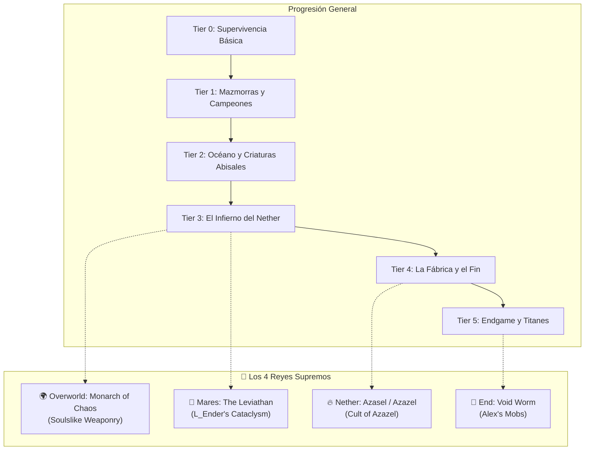

# ⚔️ Pipeline de Progresión: Jefes, Armaduras y Estrategias
### *Cenizas del Cataclismo — Minecraft 1.20.1 Forge*

Este documento establece la ruta oficial de progresión para ti y tu equipo, conectando la evolución de **armaduras y equipamiento**, las **ubicaciones de los jefes**, sus **mecánicas de combate / debilidades**, y las **recompensas** necesarias para forjar el siguiente nivel de poder.

---

## 🧭 Diagrama de Flujo y Cumbres de los Reinos

---

## 👑 Los 4 Titanes Supremos (Cumbres por Dimensión / Reino)

| Reino | Jefe Supremo | Mod | Cómo Invocar / Dónde Encontrarlo | Drop Legendario |
| :--- | :--- | :--- | :--- | :--- |
| **🌍 Overworld** | **Monarch of Chaos** | *Marium's Soulslike Weaponry* | Craftear el **Chaos Orb** con almas de Day Stalker y Night Prowler para iniciar la Tormenta de Caos. | *Crown of Chaos*, *Cape of Chaos*, *Helm of Chaos*. |
| **🌊 Mares** | **The Leviathan** | *L_Ender's Cataclysm* | En la **Sunken City** en el fondo del océano abisal. Usa el *Abyssal Egg* en el altar. | *Tidal Claws*, *Abyssal Sacrifice*. |
| **🔥 Nether** | **Azasel (Azazel)** | *Cult of Azazel* | En la imponente **Mansión del Culto de Azazel** en el Nether (3 zonas de desafíos). | Armadura de vuelo divina y *Totem of Rebirth*. |
| **🌌 End** | **Void Worm** | *Alex's Mobs* | Arrojando un **Mysterious Worm** al vacío entre las islas exteriores del End. | *Void Worm Eye*, *Void Worm Mandible* (*Dimensional Carver*). |

---

---

## 🟢 TIER 0: Los Primeros Pasos y Supervivencia (Nivel 1 - 25)

| 🛡️ Armadura Mínima | ⚔️ Armamento Sugerido | 🎒 Utilidad Indispensable |
| :--- | :--- | :--- |
| **Set de Hierro Completo** o **Armor of the Ages** (Set Samurai de Hierro) | Espada Larga / Lanza de Hierro (*Better Combat*) + Escudo | **Mochila Sophisticated Básica**, Paraglider, Cama y Antorchas |

### 👹 Jefes y Retos Iniciales:
1. **Mutant Zombie & Mutant Skeleton** (*Mutant Monsters*)
   * **Ubicación:** Generación natural nocturna en el Overworld.
   * **Estrategia:**
     * *Mutant Zombie:* Al ser derrotado caerá noqueado; **quémalo con un mechero** inmediatamente o revivirá hasta 3 veces con media vida.
     * *Mutant Skeleton:* Bloquea con escudo sus ráfagas de flechas múltiples y rueda (`R`) cuando salte al aire para esquivar su impacto sísmico.
2. **Capitanes Pillager & Bastiones** (*Takes a Pillage / Dungeons and Taverns*)
   * **Estrategia:** Ataca a distancia a los arqueros desde cobertura. Recluta a un compañero humano (`Human Companions`) con carne cocida para que absorba daño en primera línea.

🎁 **Botín Clave:** Minerales masivos, primeras Gemas de Estamina para el *Paraglider* y Diamantes para el Tier 1.

---

## 🟡 TIER 1: Mazmorras Antiguas y Criaturas de Piedra (Nivel 25 - 45)

| 🛡️ Armadura Mínima | ⚔️ Armamento Sugerido | 🎒 Utilidad Indispensable |
| :--- | :--- | :--- |
| **Set de Diamante (Protección II+)** o **Armadura de Caballero** (*Knight Quest*) | Espada Doble de Diamante / Maza Pesada + Pociones de Curación | **Stamina Vessels** (+2 corazones/estamina en Paraglider) |

### 👹 Jefes y Estrategias:

#### 1. **Ferrous Wroughtnaut** (*Mowzie's Mobs*)
* **Ubicación:** Cámaras acorazadas subterráneas (Y: -20 a 20).
* **Mecánica:** Su armadura frontal es **100% impenetrable**.
* **Estrategia:**
  1. Haz que inicie su ataque vertical pesado con hacha.
  2. Rueda hacia un costado con `R`.
  3. El hacha quedará clavada en el suelo durante 3 segundos: **golpea exclusivamente su espalda** (el punto débil expuesto).
* 🎁 **Drop:** *Wrought Helm* (casco indestructible) y *Axe of the Thousand Metal*.

#### 2. **Frostmaw** (*Mowzie's Mobs*)
* **Ubicación:** Cumbres nevadas y montañas glaciares.
* **Estrategia:** Atácalo girando en círculos para evitar su aliento de hielo continuo. Cuando salte al aire, corre hacia atrás para no recibir el golpe de impacto.
* 🎁 **Drop:** *Ice Crystal* (permite disparar rayos continuos de congelación).

#### 3. **The Corrupted Champion / Lich** (*The Graveyard*)
* **Ubicación:** Criptas subterráneas y Cementerios gigantescos.
* **Estrategia:** Mantén distancia de los charcos de corrupción oscura. Lleva cubos de leche o pociones curativas contra el efecto *Decay/Wither*.

---

## 🔵 TIER 2: El Océano Helado y la Maldición Abisal (Nivel 45 - 65)

| 🛡️ Armadura Mínima | ⚔️ Armamento Sugerido | 🎒 Utilidad Indispensable |
| :--- | :--- | :--- |
| **Set de Teratoma / Coral** (*Aquamirae*) o **Diamante Encantado (Prot IV)** | Daga Congelante / *Whisper of the Abyss* (*Aquamirae*) | Pociones de Respiración Acuática y Visión Nocturna |

### 👹 Jefes y Estrategias:

#### 1. **Ghost of Captain Cornelia** (*Aquamirae*)
* **Ubicación:** Barco fantasma sumergido en biomas de océano congelado.
* **Fases del Combate:**
  * **Fase 1 (Invocación):** Toca la flauta de cuerno o ataca a los marineros fantasma. Cornelia atacará con embestidas rápidas y clones.
  * **Fase 2 (Tormenta Helada):** Invoca un vórtice de agua congelada. Usa armas con **Daño de Fuego** para anular su regeneración pasiva.
* 🎁 **Drop:** *Terrible Sword*, *Divider*, *Golden Feather* y materiales para forjar la armadura abisal de escamas.

#### 2. **Decaying King / Old Champion** (*Soulslike Weaponry*)
* **Ubicación:** Ruinas y mausoleos subterráneos.
* **Estrategia:** Estos jefes rompen la guardia si te quedas inmóvil con escudo. Usa el esquive con frames de invulnerabilidad (`R`) y contraataca únicamente tras su combo de 3 golpes.

---

## 🔴 TIER 3: El Inframundo Volcánico (Nivel 65 - 80)

| 🛡️ Armadura Mínima | ⚔️ Armamento Sugerido | 🎒 Utilidad Indispensable |
| :--- | :--- | :--- |
| **Set de Netherite Completo** o **Set Terrible** (*Aquamirae*) | Armas de Alma (*Soulslike Weaponry*) / Espada de Diamante Filo V | **Pociones de Resistencia al Fuego** (Obligatorias) + Mochila con Magnet |

### 👹 Jefes y Estrategias:

#### 1. **Netherite Monstrosity** (*L_Ender's Cataclysm*)
* **Ubicación:** *Monstrous Forge* en el Nether (Fortaleza de lava colosal).
* **Mecánica:** Genera terremotos devastadores y charcos de lava fundida.
* **Estrategia:**
  1. No te quedes en el suelo cuando levante ambos brazos: salta con el Paraglider o súbete a los pilares de la forja.
  2. Cuando escupa lava fundida, muévete en zig-zag lateral.
  3. Ataca sus patas con armas pesadas tras sus golpes de martillo.
* 🎁 **Drop:** *Monstrous Horn* (material base para forjar el arma mítica *The Incinerator*) y lingotes de Netherite puro.

#### 2. **Ignis** (*L_Ender's Cataclysm*)
* **Ubicación:** *Burning Arena* en el Nether.
* **Fases del Combate:**
  * **Fase 1:** Ataca con una espada gigante y escudo. No golpees su escudo frontalmente o te aturdirá.
  * **Fase 2:** Desenvaina dos espadas de fuego, levita e invoca columnas de fuego ascendentes.
* **Estrategia:** Bebe poción de resistencia al fuego antes de entrar. Cuando salte al aire para caer en picada, rueda dos veces seguidas para salir del radio de explosión.
* 🎁 **Drop:** *Ignitium Ingot* (para forjar la armadura de **Ignitium**, que otorga inmunidad total al fuego y regeneración) y *The Incinerator*.

---

## 🟣 TIER 4: La Fábrica Ancestral y el Vacío (Nivel 80 - 95)

| 🛡️ Armadura Mínima | ⚔️ Armamento Sugerido | 🎒 Utilidad Indispensable |
| :--- | :--- | :--- |
| **Armadura de Ignitium** (*Cataclysm*) o **Netherite Protección IV** | *The Incinerator* / *Soulslike Moonlight Greatsword* | Escudos pesados, Manzanas Doradas, Tótems de Inmortalidad |

### 👹 Jefes y Estrategias:

#### 1. **The Harbinger** (*L_Ender's Cataclysm*)
* **Ubicación:** *Ancient Factory* (Overworld, en las profundidades cerca de Bedrock).
* **Mecánica:** Jefe mecánico con tecnología de Wither, rayos láser continuos y misiles teledirigidos.
* **Estrategia:**
  1. Cúbrete detrás de los pilares de la fábrica cuando cargue su **Rayo Láser Carmesí** (daño letal en 2 segundos).
  2. Usa escudo para bloquear los proyectiles pequeños.
  3. Cuando active su escudo reflector eléctrico, atácalo exclusivamente cuerpo a cuerpo.
* 🎁 **Drop:** *Witherite Ingot*, *Laser Gatling* y *Netherite Mechanical Arm*.

#### 2. **Void Worm** (*Alex's Mobs*)
* **Ubicación:** El Vacío del End (Lanza un **Mysterious Worm** al vacío entre islas).
* **Mecánica:** Coloso volador de múltiples segmentos que abre portales dimensionales.
* **Estrategia:**
  1. Equípate el **Paraglider** o **Elytra** para no caer al vacío infinito si te empuja.
  2. **Punto débil:** Golpea los segmentos brillantes bioluminiscentes de su cuerpo (la cabeza tiene alta resistencia).
  3. Aléjate de los portales dimensionales de salida para evitar su embestida sónica.
* 🎁 **Drop:** *Void Worm Eye* y *Void Worm Mandible* (materiales para craftear el **Dimensional Carver**, teletransportador de portales).

---

## 👑 TIER 5: Los Titanes del Vacío y el Post-Game (Nivel 95 - 100+)

| 🛡️ Armadura Mínima | ⚔️ Armamento Sugerido | 🎒 Utilidad Indispensable |
| :--- | :--- | :--- |
| **Armadura de Witherite** (*Cataclysm*) + Amuletos de *Relics* | *Dimensional Carver* + *Gauntlet of Guard* + *Soul Edge* | Tótems de Inmortalidad, Pociones de Fuerza II y Regeneración II |

### 👹 Jefes y Estrategias:

#### 1. **Ender Guardian** (*L_Ender's Cataclysm*)
* **Ubicación:** *Ruined Citadel* en las islas exteriores del End.
* **Mecánica:** Coloso que altera la gravedad y embiste demoliendo bloques.
* **Estrategia:**
  * Haz que embista contra los muros indestructibles de la ciudadela. Al chocar quedará **aturdido durante 4 segundos**, momento en el que recibe 200% de daño crítico.
* 🎁 **Drop:** *Gauntlet of Guard* (genera campos de fuerza protectores).

#### 2. **The Leviathan** (*L_Ender's Cataclysm*)
* **Ubicación:** *Sunken City* en la fosa dimensional abisal del End.
* **El Jefe Final del Modpack:**
  * Combate dividido en 3 fases subacuáticas/dimensionales.
  * Destruye los 4 núcleos dimensionales que orbitan a su alrededor antes de que su barra de salud sea vulnerable.
  * Cuidado con su habilidad de Agujero Negro: activa tu Paraglider o nada a máxima velocidad en sentido opuesto para no ser absorbido y aniquilado.
* 🎁 **Drop:** *Abyssal Sacrifice*, *Tidal Claws* y el título de Campeón de las Cenizas del Cataclismo.

---

## 🤝 Roles y Estrategia Cooperativa para el Servidor

1. **🛡️ El Tanque:**
   * **Equipo:** Armadura de Ignitium / Netherite con Escudo Pesado y hacha para desarmar enemigos.
   * **Rol:** Mantener la atención (agro) de los jefes y posicionarlos de espaldas a los atacantes.
2. **⚔️ El DPS Ágil:**
   * **Equipo:** Armaduras de movilidad (*Armor of the Ages*), espadas dobles de *Better Combat* y dagas rápidas.
   * **Rol:** Explotar los puntos débiles de los jefes aprovechando las ventanas de aturdimiento.
3. **💉 El Médico / Soporte:**
   * **Equipo:** Mochila con mejoras de pociones de salpicadura y comida curativa.
   * **Rol:** Mantenerse en retaguardia y usar el sistema **PlayerRevive** (mantener Clic Derecho 5s) en aliados que caigan en estado de desangrado.
4. **📍 Waystones en Mazmorras:** Coloquen siempre una *Waystone* en la entrada de las arenas antes de activar el combate para reaparecer de inmediato si el equipo es derrotado.
